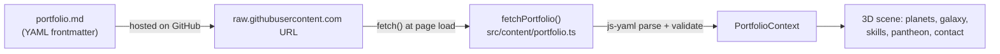

# 🚀 A Cosmic Journey — 3D Portfolio

An interactive 3D space-journey portfolio built with **React Three Fiber** and **TanStack Start**.
Visitors board a ship, fly past your experiences (planets), dive through a wormhole into a galaxy
of projects, cross a skill constellation, visit a pantheon of achievements, and finish at a black hole.

**All content comes from one Markdown file.** You don't need to touch any code to make it your own.

---

## ✨ How the portfolio data is consumed



1. Your content lives in the **YAML frontmatter** (the block between the `---` lines) of a Markdown file.
2. On page load, the app **fetches that file over HTTP** from the URL in `PORTFOLIO_MD_URL`
   ([`src/content/portfolio.ts`](src/content/portfolio.ts)).
3. The frontmatter is parsed with `js-yaml` and checked for the required keys
   (`brand`, `experiences`, `projects`, `skills`).
4. The parsed data is shared through a React context (`usePortfolio()`), and the scene
   **lays itself out automatically** from it. Add a 4th experience and the wormhole, galaxy and
   black hole all move further back to make room.
5. If the file can't be fetched or parsed, a "404 — empty space" screen shows the URL it tried.

> 💡 Because the data is fetched at runtime, **you can update your portfolio by editing the Markdown
> file on GitHub. You don't need to rebuild or redeploy.** (Raw GitHub content can take a few
> minutes to refresh its cache.)

---

## ⚙️ Configure it in 3 steps

### 1. Write your content

Copy [`src/content/portfolio.md`](src/content/portfolio.md) as a starting template and fill it in.
You can host it anywhere publicly reachable, for example the `README.md` of your
GitHub profile repo (`<user>/<user>`), or this repo itself.

### 2. Point the app at it

Pick **one** option:

**Option A: environment variable (recommended, no code change)**

Create a `.env.local` file (all `.env*` files are git-ignored):

```bash
# .env.local
VITE_PORTFOLIO_MD_URL=https://raw.githubusercontent.com/<user>/<repo>/<branch>/<path-to-file>.md
```

On Cloudflare / Vercel, set the same variable in the project's **Environment Variables** settings.

**Option B: edit the default**

Change the fallback URL in [`src/content/portfolio.ts`](src/content/portfolio.ts):

```ts
export const PORTFOLIO_MD_URL =
  (import.meta.env.VITE_PORTFOLIO_MD_URL as string | undefined) ||
  "https://raw.githubusercontent.com/<user>/<repo>/main/portfolio.md";
```

> ⚠️ Use the **raw** URL (`raw.githubusercontent.com/...`), not the normal `github.com/...` page URL.

### 3. Run it

```bash
npm install --legacy-peer-deps
npm run dev          # → http://localhost:8080
```

---

## 📄 Content schema

```yaml
---
brand:
  name: "Your Name"
  tagline: "embedded · robotics · vision"
  description: "One-line pitch shown on the intro screen."   # optional
  email: "you@example.com"
  linkedin: "https://www.linkedin.com/in/you/"
  github: "https://github.com/you"

experiences:            # planets BEFORE the wormhole (in order)
  - place: "Company"    # big display name on the planet
    name: "Job Title"
    year: "2024 → now"
    description: "What you did."                # optional
    color: "#3da9ff"    # planet main color
    accent: "#06203d"   # planet secondary color
    pattern: "grid"     # grid | stripes | gas | ice | lava
    # z: -60            # optional; auto-spaced if omitted

projects:               # planets orbiting in the galaxy
  - name: "Project"
    desc: "Short subtitle"
    details: "Longer text shown in the modal."
    stack: ["Python", "ROS2"]
    color: "#3cf0a0"
    accent: "#0a3b2a"
    pattern: "ice"
    radius: 5           # orbit radius
    speed: 0.18         # orbit speed
    size: 1.0           # planet size

skills:                 # or a flat list → treated as technical
  technical: ["C++", "Python"]
  soft: ["Leadership", "Teamwork"]

achievements:           # optional — orbiting medals in "The Pantheon"
  - name: "Certification"
    issuer: "Issuer"    # optional
    year: "2024"        # optional
    icon: "★"           # optional
    color: "#ffd27a"    # optional
    accent: "#5a3a00"   # optional
    description: "..."  # optional
---

Anything below the frontmatter is ignored by the app, so you can keep a normal README here.
```

| Key            | Required | Notes                                              |
| -------------- | :------: | -------------------------------------------------- |
| `brand`        |    ✅    | Name, tagline, contact links                       |
| `experiences`  |    ✅    | Any number; scene auto-extends                     |
| `projects`     |    ✅    | Any number; tune `radius`/`speed` to avoid overlap |
| `skills`       |    ✅    | `{ technical, soft }` or a flat list               |
| `achievements` |    ➖    | Defaults to empty                                  |

---

## 🎮 Controls

| Action              | Input                          |
| ------------------- | ------------------------------ |
| Next / prev chapter | `→` / `←`                      |
| Free roam (toggle)  | **Roam** button in the top bar |
| Fly                 | `W A S D`, `Space` / `Ctrl`    |
| Boost               | `Shift`                        |
| Release mouse       | `Esc`                          |

---

## 🌍 Deployment (free)

The project is pre-configured for **Cloudflare Workers** ([`wrangler.jsonc`](wrangler.jsonc)).
Connect this GitHub repo to **Cloudflare Pages/Workers** or **Vercel** and every `git push` deploys
automatically. Remember to set `VITE_PORTFOLIO_MD_URL` in the host's environment settings if
you use Option A.

---

## 🛠️ Tech stack

React 19 · TanStack Start / Router · React Three Fiber + drei · Three.js · Tailwind CSS v4 ·
Vite 7 · js-yaml

## 📜 License

[MIT](LICENSE) © Bacem Zarai
